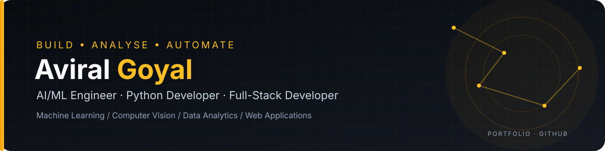

# Aviral Goyal

### Data Analyst · AI/ML Engineer · Power BI Developer

I use Python, SQL, and Power BI to analyse operational data, automate reporting, and build practical data-driven solutions. My work also includes computer vision and AI-assisted production monitoring.

  
  
  

---

## About Me

I'm a **Data Analyst and AI/ML Engineer** with hands-on experience in manufacturing analytics, operational reporting, dashboard development, and computer-vision-based production monitoring. I use Python, SQL, and Power BI to turn operational data into useful insights for decision-making.

My experience includes production KPI reporting, downtime analysis, reporting automation, and contributing to a 10-camera YOLOv8 monitoring initiative. I also build independent projects in machine learning, data analytics, and full-stack development.

- **Data Analytics & BI:** Python, SQL, Power BI, DAX, KPI reporting, data cleaning, and visualization.
- **Industrial AI & Computer Vision:** YOLOv8, OpenCV, object counting, and real-time production monitoring.
- **Automation & Data Workflows:** Python scripts, Excel data processing, REST APIs, and reporting automation.
- **Application Development:** Django REST Framework, Angular, TypeScript, and database-backed applications.

## Featured Projects

### [InsightForge AI — AI Data Analyst Agent](https://github.com/avviiiral/InsightForge_AI)

An agent-based analytics platform designed to analyse datasets from sources such as CSV, Excel, JSON, Parquet, and databases. It brings together data profiling, quality checks, correlation and anomaly analysis, chart generation, forecasting, natural-language queries, and report exports.

**Focus:** AI agents · Data Analytics · Python · LLM-assisted workflows · Automated Reporting

### [Personal Wealth Monitoring System](https://github.com/avviiiral/Personal_Wealth_Monitoring_System)

A full-stack wealth-tracking application for monitoring investments such as Indian equities, ETFs, bonds, mutual funds, and SIPs. The project focuses on transaction-driven portfolio calculations, valuation, XIRR/CAGR reporting, market/NAV updates, and role-based family access.

**Focus:** Django · Django REST Framework · Angular · TypeScript · Financial Data · PostgreSQL/SQLite

### [VisionCount Multi-Model — Computer Vision Analytics](https://github.com/avviiiral/visioncount-multi-model)

A multi-camera vision-counting system built around dedicated YOLOv8 models, RTSP camera streams, per-camera model loading, dashboard views, and CSV-based count logging.

**Focus:** Computer Vision · YOLOv8 · Python · OpenCV · Streamlit · Real-Time Video Analytics

### [Machine Learning Stock Forecasting](https://github.com/avviiiral/Machine-Learning-Stock-Forecasting)

A time-series machine learning project that prepares historical stock data, trains a forecasting model, and evaluates predictions using RMSE.

**Focus:** Machine Learning · TensorFlow · Keras · Pandas · NumPy · Time-Series Forecasting

### [TCS Stock Market Analysis — Power BI](https://github.com/avviiiral/TCS-Stock-Market-Analysis-PowerBI)

An interactive business-intelligence dashboard exploring historical stock-market data through performance comparisons, trend analysis, volume metrics, date filters, and DAX measures.

**Focus:** Power BI · DAX · Data Modelling · Data Visualization · Business Intelligence

### [Gemini Chatbot](https://github.com/avviiiral/Gemini-Chatbot)

A browser-based conversational AI demo built with Streamlit and Google's Gemini API, including session-based conversation history.

**Focus:** Generative AI · LLM Integration · Python · Streamlit · API Integration

### More Machine Learning Projects

- [Plant Disease Prediction with CNN](https://github.com/avviiiral/Plant-Disease-Prediction-with-CNN) — image classification using convolutional neural networks and TensorFlow/Keras.
- [MNIST Digit Classification with Neural Network](https://github.com/avviiiral/MNIST_Digit_Classification_with_Neural_Network) — handwritten digit recognition and model evaluation.
- [Breast Cancer Classification with Neural Network](https://github.com/avviiiral/Breast-Cancer-Classification-Neural-Network) — supervised classification workflow.
- [Bank Note Authentication with Random Forest](https://github.com/avviiiral/Bank-Note-Authentication-using-Random-Forest) — classification using a traditional machine learning model.

## Case Studies & Technical Notes

Longer write-ups with architecture notes are published on the [portfolio site](https://aviral-goyal.netlify.app/):

- [BGLIIN.AI — industrial computer vision and production monitoring](https://aviral-goyal.netlify.app/projects/bgliin-ai.html)
- [Personal Wealth Monitoring System — Django and Angular case study](https://aviral-goyal.netlify.app/projects/personal-wealth-monitoring.html)
- [AI Data Analyst Agent — Python and Streamlit case study](https://aviral-goyal.netlify.app/projects/ai-data-analyst-agent.html)
- [Designing a multi-camera monitoring pipeline](https://aviral-goyal.netlify.app/articles/multi-camera-monitoring.html)
- [Making portfolio calculations auditable](https://aviral-goyal.netlify.app/articles/auditable-portfolio-calculations.html)

## Technical Skills

**Programming & Data**

**Machine Learning & AI**

**Web Development & APIs**

**Databases, BI & Tools**

## Current Focus

- Manufacturing analytics, operational KPI reporting, and downtime analysis.
- Python and SQL automation for repeatable data workflows.
- Computer vision and AI-assisted production monitoring.
- Building clear, decision-focused Power BI dashboards.
- Developing practical machine learning and full-stack applications.

## GitHub Activity

  
  

  

> GitHub statistics are generated by third-party services and may occasionally be unavailable or subject to caching. Language percentages describe repository code, not proficiency.

## Connect

I'm interested in exchanging ideas and collaborating on practical projects in AI/ML engineering, Python development, data analytics, business intelligence, and full-stack application development.

- **Portfolio:** [aviral-goyal.netlify.app](https://aviral-goyal.netlify.app/)
- **LinkedIn:** [linkedin.com/in/avviiiral](https://www.linkedin.com/in/avviiiral/)
- **GitHub:** [github.com/avviiiral](https://github.com/avviiiral)

---

  Thanks for visiting my profile. Explore the repositories to see the projects, code, and documentation.

