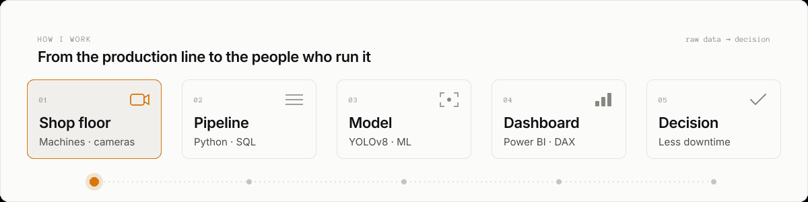
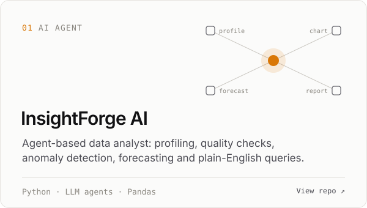
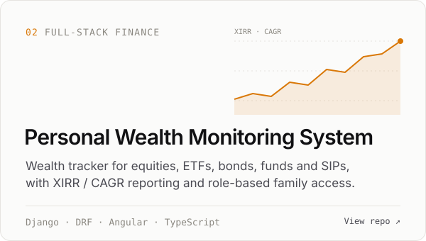
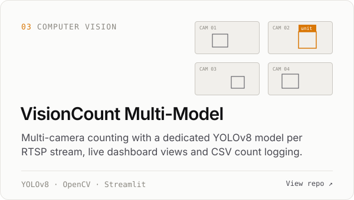
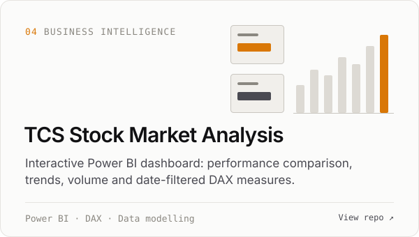
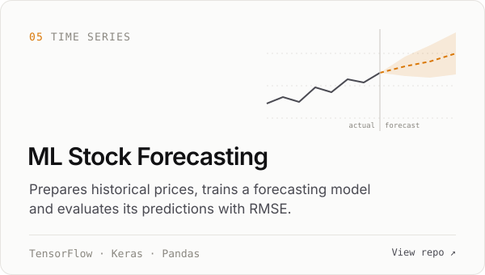
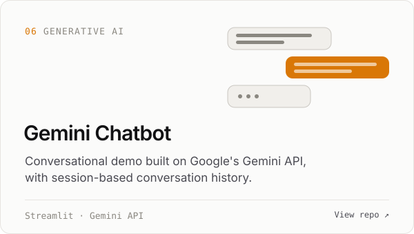

<picture>
  <source media="(prefers-color-scheme: dark)" srcset="./assets/header-dark.svg">
  <source media="(prefers-color-scheme: light)" srcset="./assets/header-light.svg">
  
</picture>

 

I'm **Aviral Goyal**, a data analyst and AI/ML engineer who works where operational data meets the factory floor. Most days that means Python and SQL pipelines that replace manual reporting, Power BI dashboards built for decisions rather than decoration, and computer-vision systems that count, monitor and flag what happens on a production line.

> **Open to work:** full-time **Data Analyst · Power BI Developer · AI/ML Engineer** roles (on-site, hybrid or remote), plus **freelance and contract projects** in dashboards, reporting automation, computer vision and internal tools. [Get in touch ↓](#get-in-touch)

<a href="https://aviral-goyal.netlify.app/"><picture><source media="(prefers-color-scheme: dark)" srcset="./assets/link-portfolio-dark.svg"></picture></a>
&nbsp;
<a href="https://www.linkedin.com/in/avviiiral/"><picture><source media="(prefers-color-scheme: dark)" srcset="./assets/link-linkedin-dark.svg"></picture></a>

 

## Now

- **Manufacturing analytics.** Production KPI reporting, downtime analysis and reporting automation.
- **Industrial computer vision.** Contributing to a 10-camera YOLOv8 production-monitoring initiative.
- **InsightForge AI.** An agent-based data analyst that profiles, charts and reports on any dataset.

 

## What I can help with

| If you need… | I deliver | Built with |
|:--|:--|:--|
| **Dashboards your team actually uses** | Power BI reports with a clean data model, tested DAX measures, row-level security and a short handover guide | Power BI, DAX, SQL, Excel |
| **Reporting that runs itself** | Python / SQL pipelines that replace manual Excel work, scheduled and documented | Python, Pandas, SQL, PostgreSQL |
| **Cameras that count and flag** | YOLOv8 counting, detection and monitoring over RTSP / CCTV streams, with a live dashboard | YOLOv8, OpenCV, Streamlit |
| **Answers from messy data** | Data cleaning, exploratory analysis, KPI definitions and forecasting with a written summary | Python, scikit-learn, TensorFlow |
| **An internal tool or MVP** | Django REST API with an Angular or Streamlit front end, Dockerised and ready to deploy | Django, DRF, Angular, Docker |
| **AI on top of your data** | LLM assistants and agents that query, profile and report on business datasets | Python, LLM APIs, Streamlit |

 

## How I work

<picture>
  <source media="(prefers-color-scheme: dark)" srcset="./assets/pipeline-dark.gif">
  
</picture>

 

## Selected work

<a href="https://github.com/avviiiral/InsightForge_AI"><picture><source media="(prefers-color-scheme: dark)" srcset="./assets/card-insightforge-dark.svg"></picture></a>
&nbsp;
<a href="https://github.com/avviiiral/Personal_Wealth_Monitoring_System"><picture><source media="(prefers-color-scheme: dark)" srcset="./assets/card-wealth-dark.svg"></picture></a>

<a href="https://github.com/avviiiral/visioncount-multi-model"><picture><source media="(prefers-color-scheme: dark)" srcset="./assets/card-visioncount-dark.svg"></picture></a>
&nbsp;
<a href="https://github.com/avviiiral/TCS-Stock-Market-Analysis-PowerBI"><picture><source media="(prefers-color-scheme: dark)" srcset="./assets/card-tcs-powerbi-dark.svg"></picture></a>

<a href="https://github.com/avviiiral/Machine-Learning-Stock-Forecasting"><picture><source media="(prefers-color-scheme: dark)" srcset="./assets/card-forecasting-dark.svg"></picture></a>
&nbsp;
<a href="https://github.com/avviiiral/Gemini-Chatbot"><picture><source media="(prefers-color-scheme: dark)" srcset="./assets/card-gemini-dark.svg"></picture></a>

<b>More machine learning</b>

 

- [Plant Disease Prediction with CNN](https://github.com/avviiiral/Plant-Disease-Prediction-with-CNN) — image classification with a convolutional network in TensorFlow / Keras.
- [MNIST Digit Classification](https://github.com/avviiiral/MNIST_Digit_Classification_with_Neural_Network) — handwritten digit recognition and evaluation.
- [Breast Cancer Classification](https://github.com/avviiiral/Breast-Cancer-Classification-Neural-Network) — supervised neural-network classification workflow.
- [Bank Note Authentication](https://github.com/avviiiral/Bank-Note-Authentication-using-Random-Forest) — classification with a random forest.

 

## Writing

Longer write-ups with architecture notes, on the [portfolio](https://aviral-goyal.netlify.app/).

| Piece | Topic |
|:--|:--|
| [BGLIIN.AI](https://aviral-goyal.netlify.app/projects/bgliin-ai.html) | Industrial computer vision and production monitoring |
| [Personal Wealth Monitoring System](https://aviral-goyal.netlify.app/projects/personal-wealth-monitoring.html) | Django and Angular case study |
| [AI Data Analyst Agent](https://aviral-goyal.netlify.app/projects/ai-data-analyst-agent.html) | Python and Streamlit case study |
| [Designing a multi-camera monitoring pipeline](https://aviral-goyal.netlify.app/articles/multi-camera-monitoring.html) | Article |
| [Making portfolio calculations auditable](https://aviral-goyal.netlify.app/articles/auditable-portfolio-calculations.html) | Article |

 

## Toolkit

| Area | Tools |
|:--|:--|
| **Data** | Python, SQL, Pandas, NumPy, Matplotlib, Excel |
| **BI** | Power BI, DAX, data modelling, KPI reporting |
| **ML & vision** | scikit-learn, TensorFlow, Keras, PyTorch, YOLOv8, OpenCV |
| **Applications** | Django, Django REST Framework, Angular, TypeScript, REST APIs, Streamlit |
| **Storage & tooling** | PostgreSQL, SQLite, Git, Docker |

 

## Working with me

<table>
<tr>
<td width="50%" valign="top">

**Hiring for a full-time role**

- Data Analyst, BI / Power BI Developer, AI/ML or Computer Vision Engineer
- Strongest fit: manufacturing, operations, supply chain and fintech teams
- Comfortable owning work end to end, from raw data to the dashboard in a review meeting
- Happy to do a take-home task or a live walkthrough of any project above

</td>
<td width="50%" valign="top">

**Hiring for a freelance project**

- **Fixed scope**: a dashboard, an automation, a proof of concept
- **Hourly or contract**: ongoing analytics, BI support, model iteration
- **How it runs**: free intro call, then a written scope, milestones with demos, and a handover with code, docs and a walkthrough
- Clear communication, regular progress updates and source code you own

</td>
</tr>
</table>

 

## Get in touch

**Have a role or a project in mind?** Message me on LinkedIn with a few lines about the problem, your data and your timeline. I usually reply within a day.

- **LinkedIn** — [linkedin.com/in/avviiiral](https://www.linkedin.com/in/avviiiral/)
- **Portfolio & case studies** — [aviral-goyal.netlify.app](https://aviral-goyal.netlify.app/)
