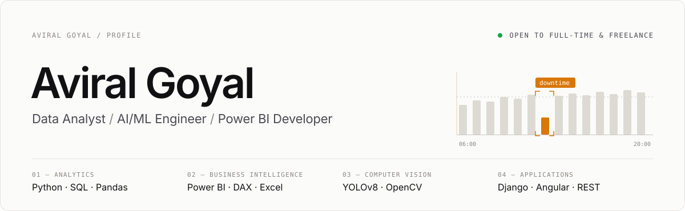

<picture>
  <source media="(prefers-color-scheme: dark)" srcset="./assets/header-dark.svg">
  <source media="(prefers-color-scheme: light)" srcset="./assets/header-light.svg">
  
</picture>

 

I work where operational data meets the factory floor. Most days that means Python and SQL pipelines that replace manual reporting, Power BI dashboards built for decisions rather than decoration, and computer-vision systems that count, monitor and flag what happens on a production line.

[Portfolio](https://aviral-goyal.netlify.app/) &nbsp;·&nbsp; [LinkedIn](https://www.linkedin.com/in/avviiiral/) &nbsp;·&nbsp; [Case studies](#writing)

 

## Now

- **Manufacturing analytics.** Production KPI reporting, downtime analysis and reporting automation.
- **Industrial computer vision.** Contributing to a 10-camera YOLOv8 production-monitoring initiative.
- **InsightForge AI.** An agent-based data analyst that profiles, charts and reports on any dataset.

 

## Selected work

| | Project | What it does | Stack |
|:--|:--|:--|:--|
| `01` | **[InsightForge AI](https://github.com/avviiiral/InsightForge_AI)** | AI data analyst agent. Profiles CSV, Excel, JSON, Parquet or database sources; runs quality checks, correlation and anomaly analysis, forecasting and natural-language queries; exports reports. | Python · LLM agents |
| `02` | **[Personal Wealth Monitoring System](https://github.com/avviiiral/Personal_Wealth_Monitoring_System)** | Family wealth tracker for Indian equities, ETFs, bonds, mutual funds and SIPs. Transaction-driven valuation, XIRR / CAGR reporting, NAV updates and role-based access. | Django · DRF · Angular |
| `03` | **[VisionCount Multi-Model](https://github.com/avviiiral/visioncount-multi-model)** | Multi-camera counting system with a dedicated YOLOv8 model per RTSP stream, live dashboard views and CSV count logging. | YOLOv8 · OpenCV · Streamlit |
| `04` | **[TCS Stock Market Analysis](https://github.com/avviiiral/TCS-Stock-Market-Analysis-PowerBI)** | Interactive Power BI dashboard covering performance comparison, trends, volume and date-filtered DAX measures. | Power BI · DAX |
| `05` | **[ML Stock Forecasting](https://github.com/avviiiral/Machine-Learning-Stock-Forecasting)** | Time-series pipeline that prepares historical prices, trains a forecasting model and evaluates it with RMSE. | TensorFlow · Keras · Pandas |
| `06` | **[Gemini Chatbot](https://github.com/avviiiral/Gemini-Chatbot)** | Browser-based conversational demo on Google's Gemini API with session-based history. | Streamlit · Gemini API |

<b>More machine learning</b>

 

- [Plant Disease Prediction with CNN](https://github.com/avviiiral/Plant-Disease-Prediction-with-CNN) — image classification with a convolutional network in TensorFlow / Keras.
- [MNIST Digit Classification](https://github.com/avviiiral/MNIST_Digit_Classification_with_Neural_Network) — handwritten digit recognition and evaluation.
- [Breast Cancer Classification](https://github.com/avviiiral/Breast-Cancer-Classification-Neural-Network) — supervised neural-network classification workflow.
- [Bank Note Authentication](https://github.com/avviiiral/Bank-Note-Authentication-using-Random-Forest) — classification with a random forest.

 

## Writing

Longer write-ups with architecture notes, on the [portfolio](https://aviral-goyal.netlify.app/).

| Piece | Topic |
|:--|:--|
| [BGLIIN.AI](https://aviral-goyal.netlify.app/projects/bgliin-ai.html) | Industrial computer vision and production monitoring |
| [Personal Wealth Monitoring System](https://aviral-goyal.netlify.app/projects/personal-wealth-monitoring.html) | Django and Angular case study |
| [AI Data Analyst Agent](https://aviral-goyal.netlify.app/projects/ai-data-analyst-agent.html) | Python and Streamlit case study |
| [Designing a multi-camera monitoring pipeline](https://aviral-goyal.netlify.app/articles/multi-camera-monitoring.html) | Article |
| [Making portfolio calculations auditable](https://aviral-goyal.netlify.app/articles/auditable-portfolio-calculations.html) | Article |

 

## Toolkit

| Area | Tools |
|:--|:--|
| **Data** | Python, SQL, Pandas, NumPy, Matplotlib, Excel |
| **BI** | Power BI, DAX, data modelling, KPI reporting |
| **ML & vision** | scikit-learn, TensorFlow, Keras, PyTorch, YOLOv8, OpenCV |
| **Applications** | Django, Django REST Framework, Angular, TypeScript, REST APIs, Streamlit |
| **Storage & tooling** | PostgreSQL, SQLite, Git, Docker |

 

---

Open to conversations about data analytics, BI and applied computer vision in manufacturing — reach me on [LinkedIn](https://www.linkedin.com/in/avviiiral/).
